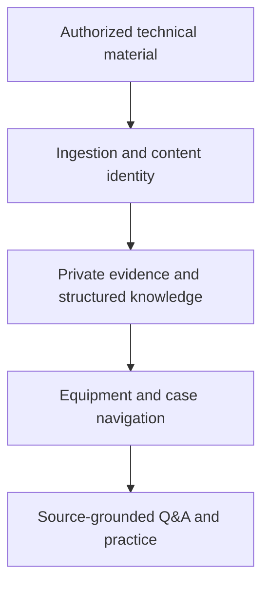

# Electrical AI Knowledge System

**Engineering knowledge for Electrical Maintenance, Protection, and Reliability**

A privately developed application for turning authorized technical documents into structured knowledge and source-grounded learning workflows.

This is a documentation-only portfolio showcase. The implementation and operational data are private.

## Engineering problem

Useful maintenance knowledge is distributed across documents, asset histories, and individual cases. Engineers need a way to connect a technical lesson to its evidence and revisit it through equipment navigation, questions, and practical training.

## Approach

The application combines document ingestion, duplicate detection, structured AI extraction, and retrieval. Extracted material distinguishes documented facts, inferences, and unknowns, while retaining references to supporting sources.

## Implemented capabilities

- Gmail attachment ingestion and manual-upload workflows.
- SHA-256 checks to avoid duplicate analysis.
- Structured knowledge cards with evidence limits.
- Equipment and case navigation.
- Semantic and lexical retrieval for questions with source references.
- Guided learning, interview practice, and troubleshooting scenarios.
- Authentication, private storage, and bounded scheduled processing.

## Explore the design

- [Architecture and engineering decisions](docs/architecture.md)
- [Synthetic evidence example](docs/synthetic-evidence-example.md)

## Technology

Next.js · TypeScript · React · Supabase · OpenAI · GitHub Actions

## Engineering judgment

Content identity is different from technical truth. Private storage does not by itself prove every access path is safe. Source references and explicit uncertainty are needed because an AI-generated explanation can still be wrong.

The current implementation also has bounded retrieval and ingestion behavior. Retrieval accuracy and engineering usefulness require a dedicated evaluation set; no numerical quality or productivity improvement is claimed here.

## Project status

The private source implements the workflows described above, and its build history includes successful CI runs. This showcase does not establish current deployment availability, production security certification, or live data quality.

## Demonstration boundary

A public example must use newly written synthetic engineering material. No internal company documents, plant-specific incidents, source filenames, email content, extracted private records, credentials, or live private application access are included.

## Portfolio

[Engineering portfolio](https://github.com/Wwwa22) · [Solar PV Monitoring](https://github.com/Wwwa22/solar-pv-monitoring-system) · [ATHIQ](https://github.com/Wwwa22/athiq-privacy-platform)

## Author

[Saeed Ali Asiri](https://www.linkedin.com/in/saeed-ali-asiri/)

Electrical Engineering · Power Systems · Protection · Maintenance & Reliability · AI-Enabled Engineering
